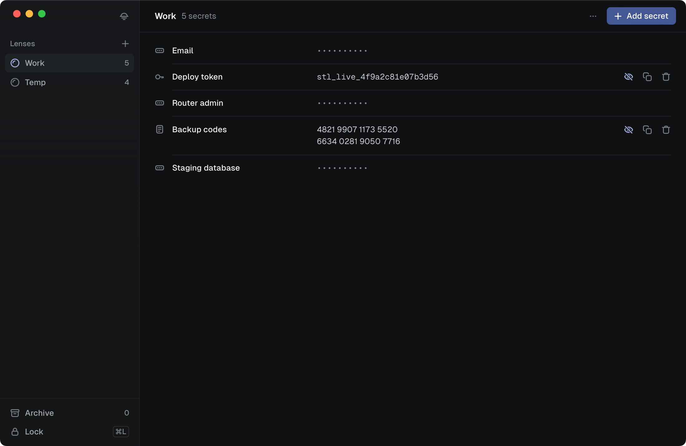

# Still

**An offline password and secret manager for your Mac, for people who want their passwords, API keys and private notes kept on their own computer instead of in someone's cloud.**

No account, no sync, no telemetry. Still never connects to the internet.

> **Early pre-release (v0.6.2).** Still is young. Don't make it the only place you keep anything you can't afford to lose, and read [Known issues](#known-issues).



## Features

- **One master password** unlocks everything. It goes through Argon2id at libsodium's highest-cost ("sensitive") setting, which makes guessing it slow and expensive.
- **Lenses:** separate collections for different parts of your life, such as work, personal or banking. Each Lens has its own encryption key.
- **Three kinds of secret:** passwords, API keys or tokens, and multi-line notes. Reveal, copy, edit or delete a secret, and rename a Lens.
- **Copy without leaving a trace.** A copied secret is cleared from the clipboard after 30 seconds, when the vault locks, and when Still quits.
- **Search** every Lens by label or Lens name with ⌘F. Values stay encrypted and are never searched.
- **A 7-day Archive.** A Lens you forget moves to the Archive for 7 days, where you can restore it or delete it for good.
- **Lock and auto-lock.** One click, or ⌘L, returns to the password screen and wipes the keys from memory. Still also locks itself after 5 minutes without activity, and when your Mac goes to sleep or its screen locks.
- **Light and dark,** following your Mac's appearance, and usable with the keyboard and screen readers.
- **Offline by design.** No servers, no accounts and no analytics. Your vault is a single private file on your Mac.
- **Open source** under the MIT licence. Read the code, or build it yourself instead of trusting a download.

## How Still protects your secrets

**Everything in your vault is encrypted.** Still uses [libsodium](https://doc.libsodium.org/), a widely used and audited crypto library, and implements no cryptography of its own.
- Your master password unlocks an app key using Argon2id. The vault file records the Argon2id settings, so they can be raised later.
- The app key unlocks a separate key for each Lens, and each secret is encrypted with its own key derived from its Lens's key, using XChaCha20-Poly1305.
- Everything else (Lens names, secret labels and types, dates and counts) is encrypted too, as one block with the secrets inside.
- Every part of the file is tied to the rest, so any change to it is detected: Still reports damaged data and changes nothing.

Anyone who can read your Mac's files sees, in the vault file, only the Argon2id settings and roughly how large the vault is. One exception: if you upgraded from an older version, the copy Still kept from before (see [Upgrading](#upgrading)) is in the old format, where Lens names and secret labels are readable. The secrets in it are still encrypted.

**Your secrets stay out of the app's window.** Still's window is a web page, and its Rust code does everything else: it holds the keys, encrypts and decrypts, and alone reads and writes the vault file. While the vault is unlocked, the window sees only Lens names and secret labels. A secret's value passes through it only while you type or reveal it. Copying goes from Rust straight to the clipboard.

**Still is careful with your vault file.**
- A save happens completely or not at all, even if your Mac crashes or loses power, and the previous version is kept as a backup.
- If the file can't be read, Still writes nothing over it, and offers to put back the newest copy it kept.
- When the vault format changes, the old file is kept beside the new one.
- Only one copy of Still uses the vault at a time.

[SECURITY.md](SECURITY.md) lists what Still doesn't protect against yet, and explains how to report a vulnerability privately.

## Download and install

Still is a macOS app. The current release is a pre-release: a universal build that runs natively on both Intel and Apple Silicon Macs. It needs **Safari 15.4 or newer**, because macOS draws Still's window with Safari's engine: any Mac on macOS 10.15 or later with Safari updates installed is fine.

1. From the [Releases page](https://github.com/dan-build/Still/releases), download the `.dmg` and `SHA256SUMS.txt`.
2. Optional but recommended: check the download. In Terminal, run `cd ~/Downloads && shasum -a 256 -c SHA256SUMS.txt`. It should print the `.dmg`'s name followed by `OK`.
3. Open the `.dmg` and drag **Still** into your **Applications** folder.
4. The app isn't signed with an Apple Developer ID yet, so macOS blocks it the first time you open it. Go to **System Settings → Privacy & Security**, scroll down, and click **Open Anyway** next to the message about Still.

**Where your vault lives:** `~/Library/Application Support/com.still.app/vault.json`, with the previous version kept as `vault.json.bak`. Deleting them deletes your vault. To back it up, quit Still and copy both files somewhere safe.

There are no Windows or Linux downloads yet. Still's tests pass on both, but it hasn't been tested there as an installed app.

## Upgrading

Install the new version over the old one. Your password and secrets stay the same, and Still tells you what it did.

- **From v0.5.0 or older:** the first time you unlock, Still upgrades your vault to the current format. It takes a few seconds longer, once, and the previous file is kept as `vault-v1.json` next to it. In that file, Lens names and secret labels are readable, as they were before the upgrade; the secrets stay encrypted. If the upgrade can't finish, your vault stays as it was and Still tries again the next time it starts.
- **From v0.1.x:** those versions kept the vault inside macOS's web storage (`~/Library/WebKit/com.still.app/`). The first time it opens, Still copies it, unchanged, into the vault file, then upgrades it when you unlock. Still never changes or deletes that old copy, and its Lens names and secret labels are readable, as they always were; the secrets stay encrypted.

**Don't go back to an older version afterwards.** Versions before v0.6.0 can't open the upgraded vault; they say so and change nothing. To go back, you'd use `vault-v1.json`, which doesn't include anything changed since the upgrade. v0.1.x only sees its old copy, so everything since would seem to be missing.

## Known issues

- **Clipboard-history apps may still record a copied secret.** Still asks them not to, and most respect that, but not all do.
- **If you used v0.1.0:** it removed spaces and line breaks at the start or end of a secret before saving. Still can't detect or restore those characters. If a saved secret doesn't work and the real one starts or ends with a space or line break, delete it and add it again.

Issues fixed in earlier versions are listed in the [CHANGELOG](CHANGELOG.md).

## Build from source

<details>
<summary>Build Still yourself instead of using the download</summary>

You need:

- **Node.js 24.** The version is in `.nvmrc`.
- **Rust**, installed through [rustup](https://rustup.rs/). `rust-toolchain.toml` pins the version, and rustup installs it for you.
- **The [Tauri prerequisites](https://tauri.app/start/prerequisites/)** for your system.

```bash
git clone https://github.com/dan-build/Still.git
cd Still
npm ci
npm run tauri:dev     # run in development
npm run tauri:build   # build the app into target/release/bundle/
npm run check         # run everything CI runs: tests, type check, Rust formatting, lints and tests
```

Development builds keep their own separate vault, so they never touch your real one.

</details>

## Roadmap

- **Signed and notarised releases,** so macOS opens Still without the "Open Anyway" step.
- **Windows and Linux packages.**

Every release keeps existing vaults working: tests open real vaults made by earlier versions, and the format only changes with a tested upgrade path.

## Contributing and security

- [CONTRIBUTING.md](CONTRIBUTING.md) covers how to build, test and send changes.
- [SECURITY.md](SECURITY.md) explains what Still protects, and how to report a vulnerability privately. Please don't use public issues for security reports.

## Licence

MIT. See [LICENSE](LICENSE).
